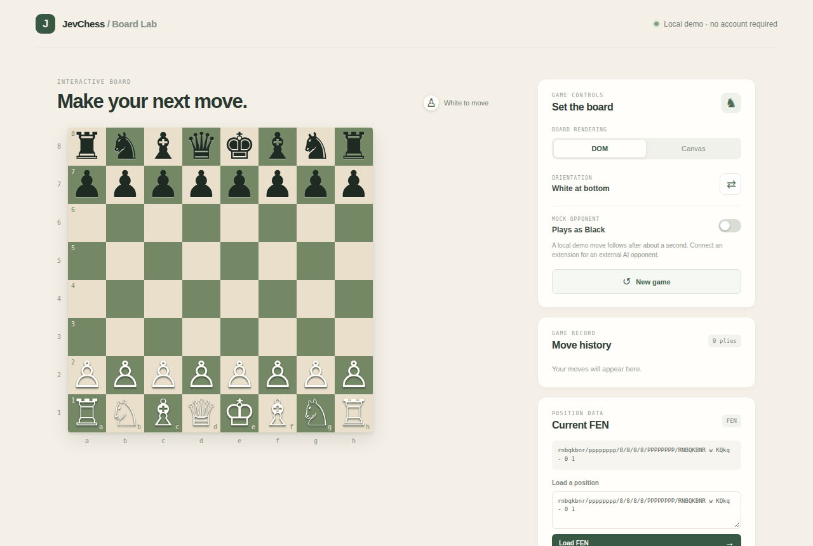
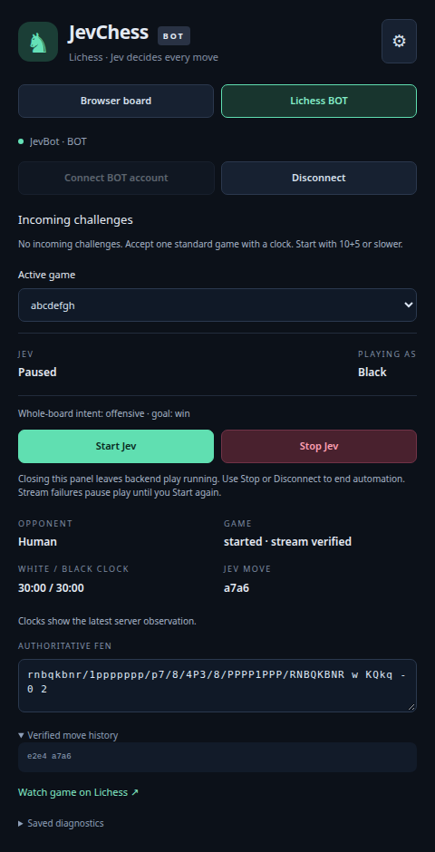
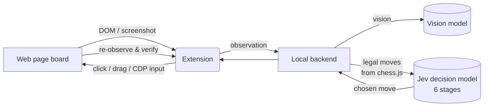

<div align="center">

# ♞ JevChess

**An AI chess player that sees the board, thinks in stages, and moves the pieces itself.**

A Chrome extension + local backend where a vision model reads any on-screen chessboard,
the **Jev** decision model picks a move from the legal options, and the extension plays it,
then checks the board to confirm it really happened. It can also run as a **Lichess BOT**.

[](https://github.com/shihabalratul/Jev-chess/actions/workflows/ci.yml)
[](LICENSE)


[](https://shihabalratul.github.io/Jev-chess/)
[](https://github.com/shihabalratul/Jev-chess/stargazers)

[▶ Live demo](https://shihabalratul.github.io/Jev-chess/) · [Quick start](#-quick-start) · [Try it free](#-try-it-for-free-mock-mode) · [How it works](docs/how-it-works.md) · [Docs](#-documentation) · [Contributing](CONTRIBUTING.md)

</div>

<p align="center">
  
  &nbsp;
  
</p>

---

## ✨ Features

- **Plays on (almost) any board.** Finds chessboards on web pages by DOM structure, square geometry or a cropped screenshot (it even reads `<canvas>` boards).
- **No engine, only AI choices.** [chess.js](https://github.com/jhlywa/chess.js) supplies the legal moves and rules facts; the Jev model picks among them in a **six-stage decision process** (assess → forecast replies → nominate → shortlist → continuations → final pick).
- **Verified moves.** A move only counts once the board is observed to have changed exactly as intended. Anything unexpected pauses play instead of guessing.
- **Four input modes.** Synthetic click, synthetic drag, and real browser input via the Chrome DevTools Protocol (click or drag).
- **Lichess BOT mode.** Play through the official Lichess Bot API with a dedicated BOT account. The token stays on your machine.
- **Keys stay on your machine.** The OpenRouter key lives only in the local backend's `.env` and never reaches the browser.
- **Full diagnostics.** Every session is journaled to `logs/<session-id>/` (screenshots, FEN, model exchanges) with credentials stripped.
- **Board Lab.** A local React demo board (DOM or Canvas, flip, FEN loading, mock opponent) for safe experimentation.
- **Well tested.** 338 unit tests plus Playwright tests that load the real extension.

## ▶️ Live demo

Play with the **Board Lab** right in your browser: **https://shihabalratul.github.io/Jev-chess/**

- **▶ Watch Jev play:** replay a real recorded game in which Jev beats a random-move opponent, with Jev's
  shortlist, forecast replies and final probabilities shown for every move.
- **♟ Play:** the Board Lab test board (DOM/Canvas rendering, flip, FEN loading, random-reply opponent).

Live AI play needs the extension and a local backend, so it isn't available on the hosted page; see the quick start below.

## 🚀 Quick start

**Requirements:** Node.js 22.13+, pnpm 10.11, Google Chrome (or Chromium).

```sh
git clone https://github.com/shihabalratul/Jev-chess.git
cd Jev-chess
pnpm install
cp -n .env.example .env        # then set OPENROUTER_API_KEY (or use mock mode below)
pnpm build                     # builds extension, demo and server
```

Run the backend and the demo board in two terminals:

```sh
pnpm dev:server
pnpm dev:demo                  # opens the Board Lab on http://127.0.0.1:4173
```

Load the extension: open `chrome://extensions` → enable **Developer mode** → **Load unpacked** →
select `apps/extension/dist`. Open the demo board, click the JevChess icon, then
**Detect Board** → **Ask Jev** → **Play Move**.

👉 The full walkthrough is in **[docs/getting-started.md](docs/getting-started.md)**.

## 🆓 Try it for free (mock mode)

Don't have an OpenRouter key? Run the backend in **mock mode**. It makes **no network calls and costs nothing**:

```sh
PROVIDER_MODE=mock pnpm dev:server
```

Then use the demo board with **DOM** rendering. In mock mode the backend reads pieces from the demo
board's HTML and makes deterministic placeholder choices instead of calling the AI models.
That's enough to see the whole pipeline work (detect → decide → move → verify) without spending anything.
It is *not* real chess thinking, and it can't read Canvas boards or play on Lichess.
Details: [Getting started → Mock mode](docs/getting-started.md#option-a-free-mock-mode).

## 🧠 How it works



Read the full explanation in **[docs/how-it-works.md](docs/how-it-works.md)**.

## 📚 Documentation

| Guide | What's inside |
|---|---|
| [Getting started](docs/getting-started.md) | Install, `.env`, mock vs live mode, loading the extension |
| [Usage guide](docs/usage.md) | Browser board mode, recognition, input modes, Chess.com notes, diagnostics |
| [Lichess BOT setup](docs/lichess-setup.md) | Dedicated BOT account, token, challenges and controls |
| [How it works](docs/how-it-works.md) | Pipeline, the six Jev stages, state safety |
| [Architecture](docs/architecture.md) | Detailed design decisions and boundaries |
| [Testing](docs/testing.md) | Unit, browser, live (paid) and benchmark commands |
| [Providers](docs/providers.md) | Model/provider references |
| [Verification log](docs/verification.md) | What has (and hasn't) been verified, and how |
| [Changelog](CHANGELOG.md) | Release history |

## 🗂️ Project structure

```
apps/
  extension/     MV3 extension: background, content script, board reader, move executor, popup & side panel
  server/        Fastify backend: OpenRouter + mock providers, decisions, Lichess bot, journal
  demo-board/    React "Board Lab" (DOM/Canvas) for local testing
packages/
  shared/            Zod schemas and contracts
  chess-core/        chess.js state, history, legal successors
  board-detection/   DOM/geometry heuristics and declarative parser
tests/               Vitest unit tests + Playwright e2e
scripts/             Benchmarks, live checks, Lichess helpers
```

## 🪦 A friendly note on fair play (from someone who learned the hard way)

Fun fact: the author of this project is **no longer welcome on Chess.com**. 🫠
JevChess played a few games, the fair-play team noticed, and my account was retired
before Jev ever got a rating. In fairness, the bot did detect the board perfectly.
Their bot detection is clearly better than my judgment.

So, a gentle tip from the chess-account graveyard: most sites don't allow outside help in
games against real people, and they *will* notice. JevChess is happiest on the
**Board Lab**, **analysis boards**, **games against site bots** and a proper
**[Lichess BOT account](docs/lichess-setup.md)**, where robots are actually invited.

Your account, your call. Just don't say I didn't warn you. ♟️⚰️

## ⚠️ Current limits

- Playing strength is **not measured**. Jev picks moves; there is no engine evaluation.
- Signed-in Chess.com games, long live autoplay sessions and arbitrary websites are not verified.
- Live Lichess move submission has not been verified yet (account and event stream are).
- Unsupported or uncertain states stop with an error rather than guessing.

See [docs/verification.md](docs/verification.md) for the exact evidence.

## 🤝 Contributing

Contributions, bug reports and ideas are very welcome! Start with [CONTRIBUTING.md](CONTRIBUTING.md).
If you like the project, a ⭐ helps others find it.

## 📄 License

[MIT](LICENSE) © shihabalratul
