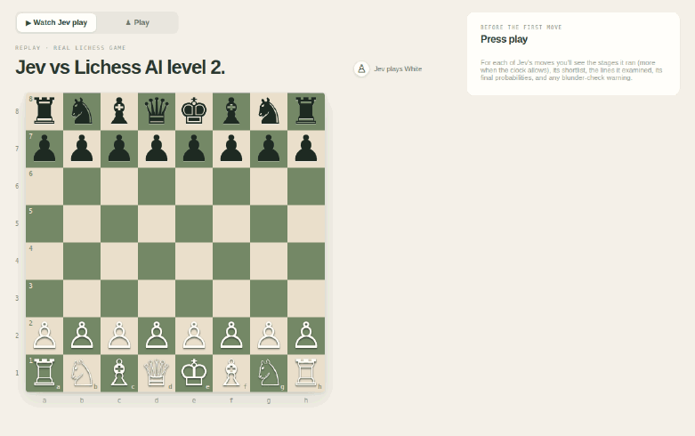
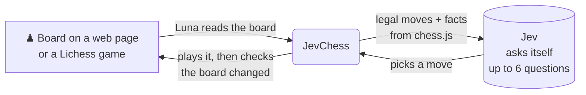

<div align="center">

# ♞ JevChess

### Can a decision model play chess? JevChess puts **Jev** to the test.

**Jev** (`typesafe/jev-1.13`) chooses every move. **Luna** (`openai/gpt-6-luna`) reads the board.
No Stockfish, no opening book: just a decision model answering one question after another,
with the chess rules engine making sure it never plays an illegal move.

[](https://shihabalratul.github.io/Jev-chess/)

[](https://github.com/shihabalratul/Jev-chess/actions/workflows/ci.yml)
[](LICENSE)


[](https://github.com/shihabalratul/Jev-chess/stargazers)



<sub>A real game: the Jev decision model (White) vs Lichess AI level 2, 10+5, checkmate on move 21. The panel shows Jev's actual recorded decisions on each move.
<a href="https://shihabalratul.github.io/Jev-chess/">Step through it yourself</a> · <a href="https://lichess.org/P5cyQ6JG">see it on Lichess</a></sub>

</div>

---

## What is this?

JevChess started with one question: **how well does Jev, a decision model, play chess?**

Jev isn't a chess engine and isn't a chatbot. It's a **decision model**: you give it a situation and a set of
options, and it picks one, with a probability for every option. JevChess turns chess into exactly that kind
of problem and watches what Jev does with it.

## 🤖 Meet the models

| | Model | Job |
|---|---|---|
| ♞ **Jev** | `typesafe/jev-1.13`, a decision model, via OpenRouter's Decisions API | **Plays the game.** Every move comes from Jev's answers to a short series of multiple-choice questions: *"Attack or defend here?"*, *"What will your opponent reply to each move?"*, *"Which of these finalists is best?"* Jev never sees an engine evaluation or a ranked list of "best moves". |
| 👁️ **Luna** | `openai/gpt-6-luna`, a vision model, via OpenRouter | **Analyses the board.** Luna works out where the pieces are from a screenshot or the page's HTML (including `<canvas>` boards), reads the visible move list, and gets past popups that block the board. It never chooses a move. |
| 📐 **chess.js** | open-source rules library | **Keeps everyone honest.** Lists the legal moves and plain rule facts (checks, captures, "this leaves your queen hanging"). It ranks nothing. |

Both models are configurable in `.env`, and JevChess never silently swaps them if one fails.

It comes in two flavours:

- 🧩 **A Chrome extension:** Luna reads a chessboard on a web page, Jev picks a move, and the extension plays it
  with the mouse, then checks that the move really happened.
- 🤖 **A Lichess bot:** plays real games through Lichess's official Bot API. Lichess supplies the position
  directly, so it's pure Jev, with no vision needed.

## ✨ What makes it interesting

| | |
|---|---|
| 👀 **It reads almost any board** | HTML boards, `<canvas>` boards, flipped boards. When the page alone isn't enough, Luna analyses a screenshot. |
| 🧠 **You can see Jev think** | Every Jev decision is logged: intent, shortlist, predicted replies, probabilities. The [live demo](https://shihabalratul.github.io/Jev-chess/) shows all of it. |
| ⏱️ **It manages its clock** | On Lichess it thinks harder when it has time (up to 6 stages) and faster when it doesn't. |
| 🛟 **Jev checks itself for blunders** | If Jev's pick hangs a piece or allows mate in one, Jev is asked to reconsider, and still makes the final call. |
| ✅ **It never guesses** | Moves only count once the board is seen to change. If anything looks off, it stops instead of guessing. |
| 🔒 **Your keys stay home** | API keys live in a small local server and never touch the browser. |

## 🏆 So, how well does Jev play?

Honestly? **About as well as Lichess's level 2–3 computer.** In the first test series Jev played six
casual 10+5 games against Lichess's built-in AI, choosing every move itself:

| Opponent | Result |
|---|---|
| Lichess AI level 1 | ✅ Won by checkmate |
| Lichess AI level 2 | ✅ Won by checkmate *(that's the game in the GIF)* |
| Lichess AI levels 3–6 | ❌ Lost |

All 176 moves were played and confirmed without a single hiccup, at roughly **1–10 cents per game** in API costs.
Six games is a tiny sample, so this is a first impression, not a rating.
([Full results](docs/verification.md#lichess-play-against-lichess-ai-2026-11-18))

## 🚀 Try it

### Just watch: no install needed
Open the **[live demo](https://shihabalratul.github.io/Jev-chess/)** to replay Jev's game move by move, or
switch to *Play* and try the board yourself.

### Run it yourself
You'll need **Node.js 22.13+**, **pnpm 10** and **Chrome**.

```sh
git clone https://github.com/shihabalratul/Jev-chess.git
cd Jev-chess
pnpm install
cp -n .env.example .env
pnpm build
```

Then start the local server and the practice board, each in its own terminal:

```sh
pnpm dev:server      # the backend that talks to the AI
pnpm dev:demo        # a practice board at http://127.0.0.1:4173
```

Finally, load the extension: open `chrome://extensions` → turn on **Developer mode** → **Load unpacked** →
choose `apps/extension/dist`. Open the practice board, click the JevChess icon, and press
**Detect Board → Ask Jev → Play Move**. 🎉

> **No API key? No problem.** Run `PROVIDER_MODE=mock pnpm dev:server` instead. It costs nothing and makes
> no network calls. The moves are placeholders rather than real AI thinking, but you can see the whole
> detect → decide → move → verify loop working. For real moves, add an [OpenRouter](https://openrouter.ai)
> key to `.env`.

Step-by-step guide and troubleshooting: **[Getting started](docs/getting-started.md)**.
Want it to play on Lichess? See **[Lichess bot setup](docs/lichess-setup.md)**.

## 🧠 How it works, in 30 seconds



1. **See (Luna):** Luna analyses the board on the page, or the Lichess game stream supplies it directly.
2. **Know the rules (chess.js):** [chess.js](https://github.com/jhlywa/chess.js) works out every legal move, plus facts like "this leaves your queen hanging".
3. **Decide (Jev):** Jev answers its staged questions and picks a move. It can only pick legal ones.
4. **Act and verify:** play the move, look again, and only trust it once the board agrees.

The detailed version is in **[How it works](docs/how-it-works.md)**.

## 🪦 A friendly note on fair play (from someone who learned the hard way)

Fun fact: the author of this project is **no longer welcome on Chess.com**. 🫠
JevChess played a few games, the fair-play team noticed, and my account was retired
before Jev ever got a rating. In fairness, the bot did detect the board perfectly.
Their bot detection is clearly better than my judgment.

So, a gentle tip from the chess-account graveyard: most sites don't allow outside help in
games against real people, and they *will* notice. JevChess is happiest on the
**practice board**, **analysis boards**, **games against site bots** and a proper
**[Lichess BOT account](docs/lichess-setup.md)**, where robots are actually invited.

Your account, your call. Just don't say I didn't warn you. ♟️⚰️

## ❓ FAQ

<details>
<summary><b>Does it use Stockfish or another chess engine?</b></summary>

No. chess.js only supplies rules facts (which moves are legal, what a move captures, whether it allows mate in one),
and Luna only reads the board. Every choice is Jev's. That's the whole point of the experiment: testing how a
decision model plays chess.
</details>

<details>
<summary><b>How much does it cost to run?</b></summary>

Mock mode is free. With real AI, a whole casual 10+5 Lichess game cost about $0.01–0.10 in the first test series.
Browser mode always runs the full six stages, so each move there costs a bit more.
</details>

<details>
<summary><b>Which websites does it work on?</b></summary>

The included practice board, Chess.com's public analysis board (tested), and in principle any page with a visible board.
Unknown boards fall back to generic detection or a screenshot. It isn't verified on every site, and it stops
with an error instead of guessing when it isn't sure.
</details>

<details>
<summary><b>Is my API key safe?</b></summary>

Keys live in `.env` on your own machine and are only used by the local backend. They're never sent to the
extension, a web page or the logs. See [SECURITY.md](SECURITY.md).
</details>

<details>
<summary><b>Can I use a different AI model?</b></summary>

Yes. `JEV_MODEL` (default `typesafe/jev-1.13`) chooses the moves and `VISION_MODEL` (default
`openai/gpt-6-luna`) reads the board. JevChess will never silently swap to a different model if yours fails.
It reports the error instead.
</details>

## 📚 Documentation

| Guide | What's inside |
|---|---|
| [Getting started](docs/getting-started.md) | Install, free mock mode vs live mode, loading the extension |
| [Usage guide](docs/usage.md) | Board detection, input modes, Chess.com notes, saved diagnostics |
| [Lichess bot setup](docs/lichess-setup.md) | BOT account, token, challenges, stats and reports |
| [How it works](docs/how-it-works.md) | Jev's stages, clock-based depth, blunder check, safety rules |
| [Architecture](docs/architecture.md) | Design decisions and boundaries, in depth |
| [Testing](docs/testing.md) | Unit, browser, benchmark and live-check commands |
| [Verification log](docs/verification.md) | Exactly what has been tested live, and how |
| [Changelog](CHANGELOG.md) | What changed in each release |

<details>
<summary><b>🗂️ Project structure</b></summary>

```
apps/
  extension/     Chrome extension (MV3): board reader, move executor, popup & side panel
  server/        Local backend (Fastify): AI providers, Jev's decision stages, Lichess bot, logs
  demo-board/    The practice board and replay (also hosted on GitHub Pages)
packages/
  shared/            Shared schemas and types (Zod)
  chess-core/        Game state and history on top of chess.js
  board-detection/   Finding and parsing boards on web pages
tests/               340+ unit tests (Vitest) and browser tests (Playwright)
scripts/             Benchmarks, live checks, Lichess stats and reports
```
</details>

## ⚠️ Known limits

- Strength is only roughly estimated (see above), and there is no engine to fall back on.
- Signed-in Chess.com games, long autoplay sessions and arbitrary websites aren't verified.
- Clock-based depth and the blunder check currently only run in Lichess mode.

## 🤝 Contributing

Ideas, bug reports and pull requests are very welcome, and you don't need an API key to get started
(mock mode is free). Have a look at [CONTRIBUTING.md](CONTRIBUTING.md) and the
[good first issues](https://github.com/shihabalratul/Jev-chess/labels/good%20first%20issue).

**If JevChess made you smile, please give it a ⭐. It really helps other people find it.**

## 📄 License

[MIT](LICENSE) © shihabalratul
