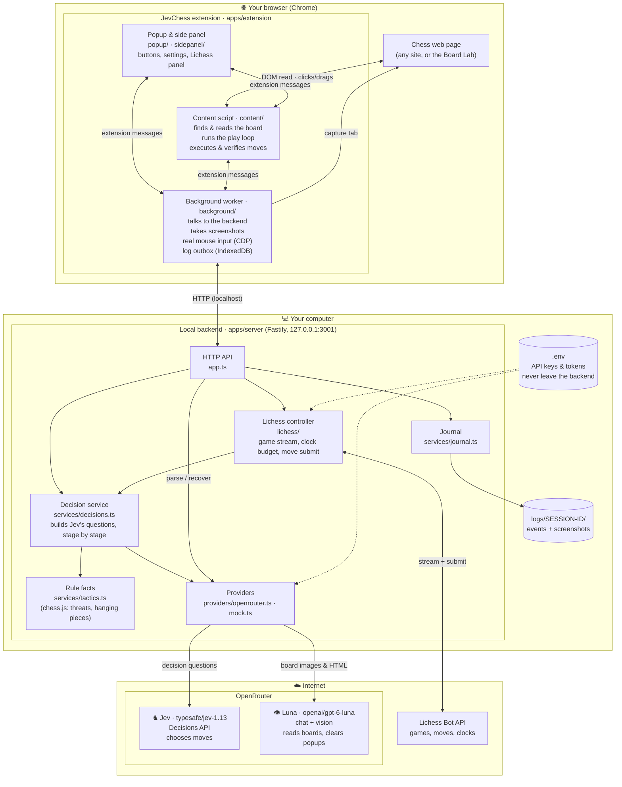
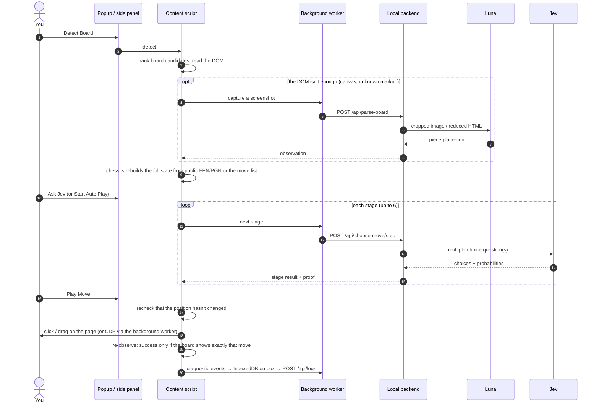
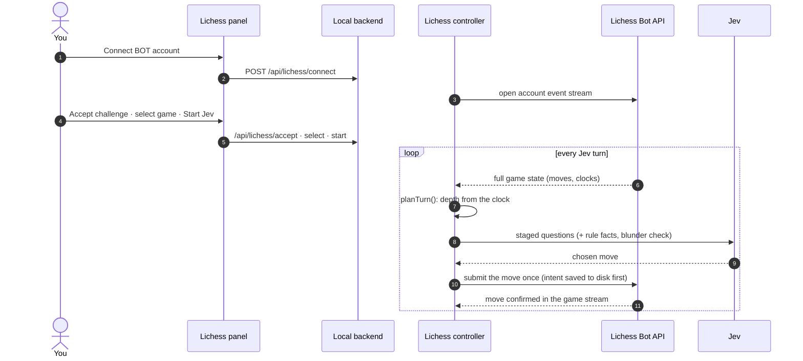
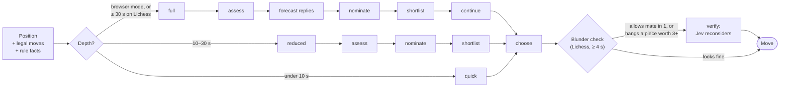
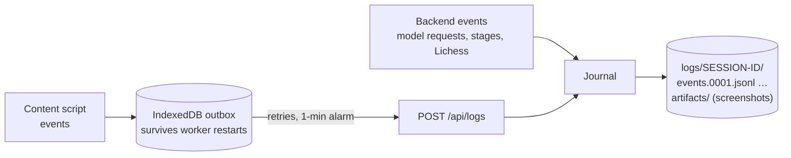

# Architecture guide

**Start here** if you want to understand how JevChess fits together. This guide is written for people first,
and it's precise enough for AI coding agents too: every box names its real folder.
For the dense design record (every edge case and decision), see [architecture.md](architecture.md).

> **TL;DR:** JevChess exists to test how **Jev** (`typesafe/jev-1.13`), a *decision model*, plays chess.
> **Luna** (`openai/gpt-6-luna`) reads boards, **chess.js** enforces the rules, and **Jev** makes every
> choice. A Chrome extension handles web pages, a small local backend talks to the AI and to Lichess, and
> nothing is trusted until it's observed or validated.

---

## 1. The big picture

**Shared building blocks** (in `packages/`, used by both sides):

| Package | What it does |
|---|---|
| `packages/shared` | Zod schemas and types for every message and API body, plus log redaction |
| `packages/chess-core` | Game state on top of chess.js: replaying history, legal moves, "is this exactly one legal move later?" |
| `packages/board-detection` | Finding boards on a page, reading DOM/geometry, the safe declarative parser |

The **Board Lab** (`apps/demo-board`) is a React practice board, used for local testing and as the
[hosted demo](https://shihabalratul.github.io/Jev-chess/).

---

## 2. Who does what

| Part | Responsibility | Never does |
|---|---|---|
| **Jev** (decision model) | Picks an option, with probabilities, for each question: intent, replies, nominations, shortlist, continuations, the final move | See an engine evaluation; choose an illegal move |
| **Luna** (vision model) | Reads piece placement from a screenshot or reduced HTML, interprets visible move lists, finds a safe way past popups | Choose a chess move |
| **chess.js** | Legal moves, game state, rule facts (checks, captures, mate-in-one, hanging pieces) | Rank or recommend moves |
| **Content script** | Owns the play loop next to the board: detect → read → decide → move → verify | Hold API keys |
| **Background worker** | Short privileged jobs: backend fetch, screenshot, CDP input, log delivery | Run the game loop (workers can be suspended) |
| **Backend** | Holds secrets, calls OpenRouter and Lichess, builds Jev's questions, writes logs | Store anything in the browser |

---

## 3. Browser mode, one move at a time

The loop runs **in the content script, next to the board**, so it sees page changes directly and can be
cancelled instantly (**Stop**, or **Esc** in the board tab). Each stage is a separate, cancellable request.

---

## 4. Lichess mode

There's no screen reading here: Lichess supplies the position, so **Luna isn't used**. The game loop runs in the
**backend**, which is why closing the popup doesn't stop play (use **Stop Jev** or **Disconnect**).

---

## 5. Inside one decision

- Every box is a question **Jev** answers. chess.js only supplies the options and facts.
- Limits: 10 s per stage, 45 s per decision. A single legal move is labelled *forced*.
- On Lichess, Jev's earlier answers for the same exact position can be reused (`DecisionCache` in `lichess/budget.ts`).

The full walk-through, with an example from a real game, is in [how-it-works.md](how-it-works.md#3-choosing-a-move-jevs-stages).

---

## 6. The safety rules (invariants)

These are the project's non-negotiables. Changes that break one of them are bugs, even if a test passes.

1. **Secrets stay in the backend.** `OPENROUTER_API_KEY` and `LICHESS_TOKEN` live only in `.env`, and never reach the extension, a page or the logs.
2. **No silent model swaps.** If Jev or Luna fails, report the error. Never fall back to mock mode or another model.
3. **No guessed chess state.** Castling rights, turn and counters come from public FEN/PGN or a complete move list. If they're missing or contradictory, pause.
4. **One legal step at a time.** A new observation must be unchanged, exactly one legal move later, or a complete history that extends the tracked game. Anything else pauses.
5. **Moves count only when observed.** Browser moves are verified by re-reading the board; Lichess moves by the game stream. A lost Lichess response is reconciled, never blindly retried.
6. **Jev makes every chess choice.** No engine, no opening book, no hardcoded strategy. Luna and recovery may never pick a different move.
7. **No site-specific state shortcuts.** No reading private game objects or hidden site APIs. Only visible UI and public exports.
8. **Mocked is labelled mocked.** Mock results are never reported as live verification.

---

## 7. Backend API

| Endpoint | Used by | Purpose |
|---|---|---|
| `GET /health` | anyone | Mode (`live`/`mock`), configured models, whether a key is set |
| `POST /api/parse-board` | extension | Luna reads a board from a screenshot or reduced HTML |
| `POST /api/discover-parser` | extension | Luna proposes a safe, declarative parsing rule for an unfamiliar board |
| `POST /api/choose-move/step` | extension | Run the next Jev stage; a proof ties earlier answers to the request |
| `POST /api/choose-move` | extension, scripts | Run the whole staged decision in one call |
| `POST /api/recover-ui` | extension | Luna suggests how to get past a popup (wait, dismiss, redetect, choose the requested promotion) |
| `POST /api/logs` | extension | Deliver queued diagnostic events |
| `POST /api/lichess/{status,connect,disconnect,accept,select,start,stop}` | Lichess panel | Control the Lichess bot (needs the `BACKEND_TOKEN` pairing) |

All bodies are validated with the Zod schemas in `packages/shared`. Requests are rate-limited, and only the
configured extension ID and `CORS_ORIGINS` may call the backend.

---

## 8. Logs and diagnostics

- Append-only JSON Lines, rotated at 20 MiB, never deleted automatically. Set `LOG_DIR` to move them.
- Credentials, auth headers, pairing tokens and form values are stripped. Screenshots mask form fields.
- Lichess moves in flight are checkpointed in `logs/lichess-intents/`. Don't delete these to "unstick" a move.
- `pnpm lichess:report` and `pnpm lichess:stats` summarise the journals offline.

---

## 9. Where to change things

| I want to… | Look in |
|---|---|
| Change the questions Jev is asked, or add a stage | `apps/server/src/services/decisions.ts`, `packages/shared/src/index.ts` (`DECISION_STAGES`) |
| Add a rule fact (e.g. a new tactical warning) | `apps/server/src/services/tactics.ts` |
| Change how Lichess budgets time | `apps/server/src/lichess/budget.ts` (`planTurn`) |
| Support a new kind of board | `packages/board-detection/src`, `apps/extension/src/parsing/BoardReader.ts` |
| Change how moves are clicked/dragged | `apps/extension/src/execution/MoveExecutor.ts` |
| Handle a new popup or promotion picker | `apps/extension/src/execution/recovery.ts`, `MoveExecutor.ts` |
| Change the play loop or Stop behaviour | `apps/extension/src/controllers/AutoPlayController.ts` |
| Talk to a different AI provider | `apps/server/src/providers/` (implement `types.ts`) |
| Change the popup or side panel | `apps/extension/src/popup/` |
| Change the demo or replay | `apps/demo-board/src/` (`Replay.tsx`, `replays/*.json`) |

Then run `pnpm typecheck && pnpm test` (plus `pnpm test:e2e` for extension changes). See [testing.md](testing.md).

---

## 10. Glossary

| Term | Meaning |
|---|---|
| **Decision model** | A model that picks one option from a list and gives a probability for each. Jev is one. |
| **Stage** | One round of questions to Jev (assess, reply, nominate, shortlist, continue, choose, verify). |
| **Depth** | How many stages run: `full` (6), `reduced` (4) or `quick` (1). |
| **FEN** | A one-line text snapshot of a chess position, including turn and castling rights. |
| **PGN / SAN** | Move-list formats, e.g. `1. e4 e5 2. Nf3` (SAN = the move notation inside PGN). |
| **UCI** | Move notation by squares, e.g. `e2e4`, `e7e8q`. Used as option keys for Jev. |
| **Ply** | One move by one side (a "move" in chess usually means two plies). |
| **Observation** | What JevChess saw on the board at one moment: placement, orientation, any public metadata. |
| **Mock mode** | `PROVIDER_MODE=mock`: free, offline placeholder providers for development and tests. |
