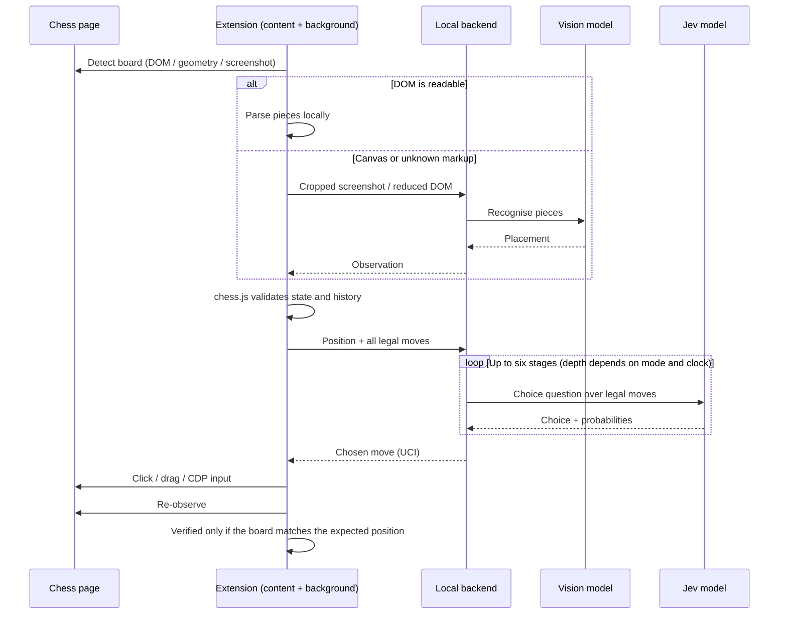

# How JevChess works

JevChess splits chess into three jobs that are easy to get wrong when mixed together:

1. **Seeing**: what pieces are where? *(DOM parsing or a vision model)*
2. **Knowing the rules**: what moves are legal, whose turn, castling rights? *([chess.js](https://github.com/jhlywa/chess.js), never an AI guess)*
3. **Choosing**: which legal move to play? *(the Jev decision model)*

Then it acts, and **checks that the board really changed** before trusting the move.

## 1. Finding and reading the board

The content script ranks board candidates using grid structure, chess-related attributes, labels,
piece classes and square geometry. You can also pick a board manually with **Select Board**.

Reading pieces tries, in order:

1. **Cached declarative rules** learned for this page (selectors and attribute maps only, never generated code);
2. **Generic DOM/geometry heuristics**;
3. **Vision model on a reduced, sanitized DOM**;
4. **Vision model on a cropped screenshot** (this is how `<canvas>` boards work);
5. **Hybrid** combinations.

Results are cached by fingerprint, so an unchanged board doesn't trigger new model calls.

## 2. Knowing the full game state

A picture shows pieces, but not **whose turn it is, castling rights, en-passant or move counters**.
JevChess never guesses these. It gets them from:

- a public FEN/PGN on the page (e.g. Chess.com's *Share Game* export), or
- a **complete visible move list**, replayed move by move with chess.js, or
- an optional manual seed FEN (advanced fallback).

After that, every new observation must be either unchanged or **exactly one legal move** from the
tracked position (or a complete history that extends it). Anything else (a teleporting piece, a
contradictory move list) **pauses play** instead of guessing.

## 3. Choosing a move: Jev's stages

The backend sends Jev a description that names every piece and square, plus the exact rule facts
from chess.js (captures, checks, mates, resulting positions). Jev only ever chooses **among legal moves**.
Each stage is a multiple-choice question for Jev, and later stages carry its earlier answers.

| Stage | Question for Jev |
|---|---|
| Assess | Look at the whole board: offensive or defensive intent this turn? |
| Forecast replies | For each of my legal moves, what is the opponent's likely reply? |
| Nominate | For each piece that can move, which move is its best? |
| Shortlist | Using Jev's probabilities, which nominees are finalists? |
| Continue | For each finalist and its forecast reply, what is my follow-up? |
| Choose | Final pick among the finalists. |
| *Verify* | *Only if the blunder check fires (see below).* |

Independent questions run in parallel with bounded concurrency. Each stage has a 10-second limit
and the whole decision has 45 seconds. A single forced move is labeled as such. There is **no engine,
no opening book and no hardcoded strategy**; chess.js supplies facts, Jev decides.

### Depth depends on the mode

- **Browser mode** always runs the **full six stages**.
- **Lichess mode** plans each turn from the clock: roughly an even share of the remaining time plus most
  of the increment.

| Time available for the turn | Depth | Stages |
|---|---|---|
| 30 s or more | `full` | all six |
| 10–30 s | `reduced` | assess → nominate → shortlist → choose |
| under 10 s | `quick` | one choose over every legal move |

In Lichess mode Jev also gets **tactical rule facts**: for every candidate, whether it allows mate in one,
which of your pieces are left attacked more than defended, and the opponent's largest capture. These are
attack/defence counts that ignore pins and x-rays. They describe moves; they don't rank them.

### Blunder check

When there are at least 4 seconds, chess.js checks Jev's chosen move. If it **allows mate in one** or
**leaves a piece worth 3+ exposed** beyond what it captured, a `verify` stage asks Jev to reconsider. It
gets the warning, its original move and every unflagged alternative, with the flagged move listed last.
Jev still makes the call: it may keep its move.

**Example** from the [live replay](https://shihabalratul.github.io/Jev-chess/): on move 8 against Lichess AI
level 2, Jev's choose stage was tied 49%/49% between Qxe6+ and fxe6 and picked Qxe6+. The check flagged it
("leaves your queen on e6 exposed"), and Jev switched to **fxe6**.

### Reuse

Within a Lichess game, Jev's own earlier answers are cached by exact position and reused at the same or a
lower depth. After a full-depth decision, the reply and continuation it examined are stored and only used
when time is short and that exact line happens. The cache never invents a move.

> Playing strength is only roughly known: in six casual games Jev beat Lichess AI levels 1–2 and lost to
> levels 3–6 ([details](verification.md#lichess-play-against-lichess-ai-2026-11-18)). `pnpm benchmark:puzzles --live`
> scores a fixed tactics set; `pnpm benchmark:jev --live` runs a small controlled comparison.

## 4. Making the move

| Input mode | How |
|---|---|
| Click | Synthetic pointer events: click source, then target |
| Drag | Synthetic drag from source to target |
| Browser click / drag | Real input through `chrome.debugger` (Chrome DevTools Protocol) |

Before input, the extension re-checks that the position is still the one Jev decided on.
After input, it re-observes the board; the move is **successful only if the new placement matches**.
Promotions are handled through generic `data-promotion` / `aria-label` controls, otherwise play pauses.

**Stop** (or **Esc**) aborts pending decisions and further input immediately.

## 5. Lichess BOT mode

In Lichess mode there's no screen reading at all. The backend uses the **official Lichess Bot API**
with a `bot:play` token kept in `.env`. Move history, color and clocks come straight from Lichess,
Jev's depth follows the clock (above), and Jev still makes every strategic choice. Each move is
submitted once and only counts after Lichess's own game stream confirms it.
See [lichess-setup.md](lichess-setup.md).

## 6. Security and privacy

- The OpenRouter and Lichess credentials live **only in the backend's `.env`**.
- The backend binds to loopback, accepts only the configured extension ID and CORS origins, and rate-limits requests.
- An optional `BACKEND_TOKEN` pairs the extension with the backend.
- Session journals strip credentials, auth headers and form values; screenshots mask form fields.

## Want more detail?

- [architecture.md](architecture.md): full design boundaries and trade-offs
- [usage.md](usage.md): recognition and diagnostic details
- [verification.md](verification.md): what has been tested live versus mocked
