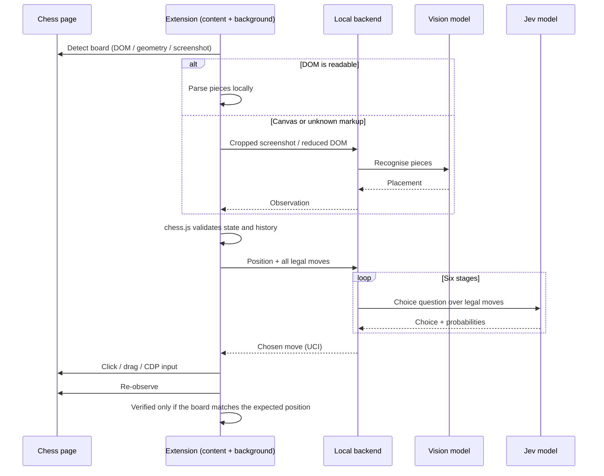

# How JevChess works

JevChess splits chess into three jobs that are easy to get wrong when mixed together:

1. **Seeing**: what pieces are where? *(DOM parsing or a vision model)*
2. **Knowing the rules**: what moves are legal, whose turn, castling rights? *([chess.js](https://github.com/jhlywa/chess.js), never an AI guess)*
3. **Choosing**: which legal move to play? *(the Jev decision model)*

Then it acts, and **checks that the board really changed** before trusting the move.

## 1. Finding and reading the board

The content script ranks board candidates using grid structure, chess-related attributes, labels,
piece classes and square geometry. You can also pick a board manually with **Select Board**.

Reading pieces tries, in order:

1. **Cached declarative rules** learned for this page (selectors and attribute maps only, never generated code);
2. **Generic DOM/geometry heuristics**;
3. **Vision model on a reduced, sanitized DOM**;
4. **Vision model on a cropped screenshot** (this is how `<canvas>` boards work);
5. **Hybrid** combinations.

Results are cached by fingerprint, so an unchanged board doesn't trigger new model calls.

## 2. Knowing the full game state

A picture shows pieces, but not **whose turn it is, castling rights, en-passant or move counters**.
JevChess never guesses these. It gets them from:

- a public FEN/PGN on the page (e.g. Chess.com's *Share Game* export), or
- a **complete visible move list**, replayed move by move with chess.js, or
- an optional manual seed FEN (advanced fallback).

After that, every new observation must be either unchanged or **exactly one legal move** from the
tracked position (or a complete history that extends it). Anything else (a teleporting piece, a
contradictory move list) **pauses play** instead of guessing.

## 3. Choosing a move: Jev's six stages

The backend sends Jev a description that names every piece and square, plus the exact rules facts
from chess.js (captures, checks, mates, resulting positions). Jev only ever chooses **among legal moves**.

| Stage | Question for Jev |
|---|---|
| 1. Assess | Look at the whole board: offensive or defensive intent? |
| 2. Forecast | For each of my legal moves, what is the opponent's likely reply? |
| 3. Nominate | For each piece that can move, which move is its best? |
| 4. Shortlist | Using Jev's probabilities, which nominees are finalists? |
| 5. Continue | For each finalist, what continuation follows? |
| 6. Select | Final pick. |

Independent questions run in parallel with bounded concurrency. Each stage has a 10-second limit
and the whole decision has 45 seconds. A single forced move is labeled as such. There is **no engine,
no opening book and no hardcoded strategy**; chess.js supplies facts, Jev decides.

> Playing strength hasn't been measured. `pnpm benchmark:jev` runs a small controlled comparison,
> but it can't establish a rating.

## 4. Making the move

| Input mode | How |
|---|---|
| Click | Synthetic pointer events: click source, then target |
| Drag | Synthetic drag from source to target |
| Browser click / drag | Real input through `chrome.debugger` (Chrome DevTools Protocol) |

Before input, the extension re-checks that the position is still the one Jev decided on.
After input, it re-observes the board; the move is **successful only if the new placement matches**.
Promotions are handled through generic `data-promotion` / `aria-label` controls, otherwise play pauses.

**Stop** (or **Esc**) aborts pending decisions and further input immediately.

## 5. Lichess BOT mode

In Lichess mode there's no screen reading at all. The backend uses the **official Lichess Bot API**
with a `bot:play` token kept in `.env`. Move history, color and clocks come straight from Lichess,
and Jev still makes every strategic choice. See [lichess-setup.md](lichess-setup.md).

## 6. Security and privacy

- The OpenRouter and Lichess credentials live **only in the backend's `.env`**.
- The backend binds to loopback, accepts only the configured extension ID and CORS origins, and rate-limits requests.
- An optional `BACKEND_TOKEN` pairs the extension with the backend.
- Session journals strip credentials, auth headers and form values; screenshots mask form fields.

## Want more detail?

- [architecture.md](architecture.md): full design boundaries and trade-offs
- [usage.md](usage.md): recognition and diagnostic details
- [verification.md](verification.md): what has been tested live versus mocked
